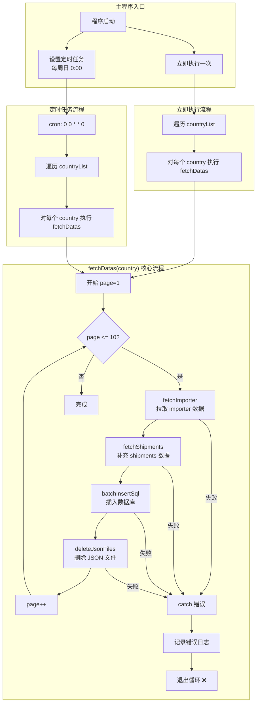
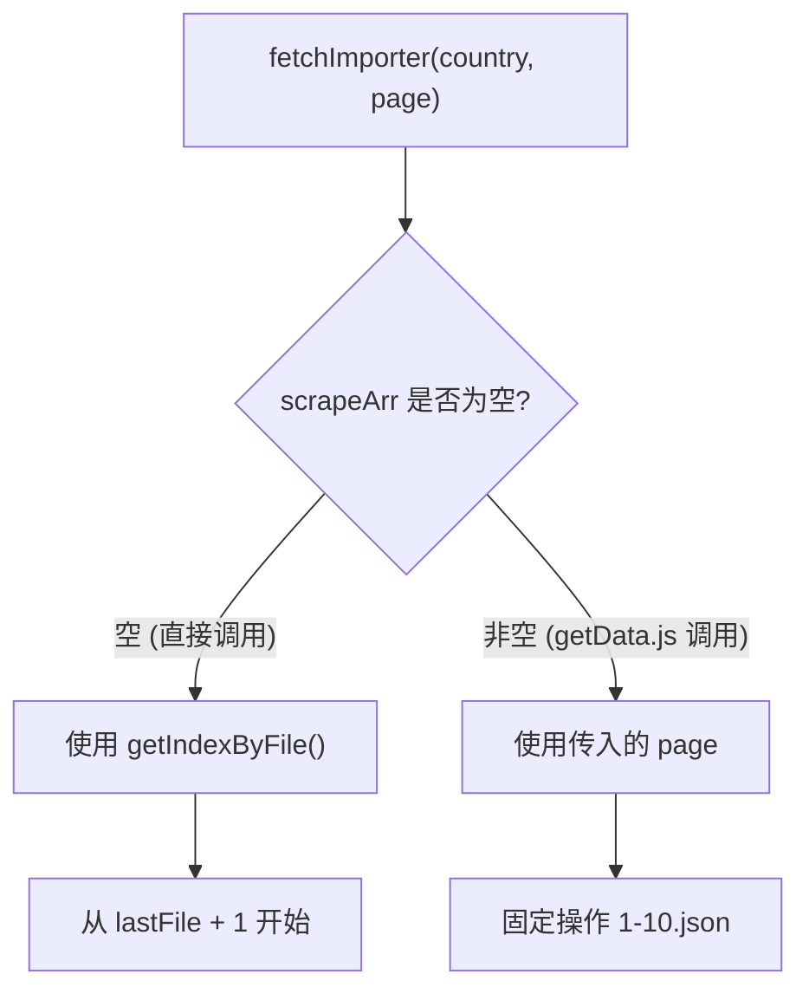
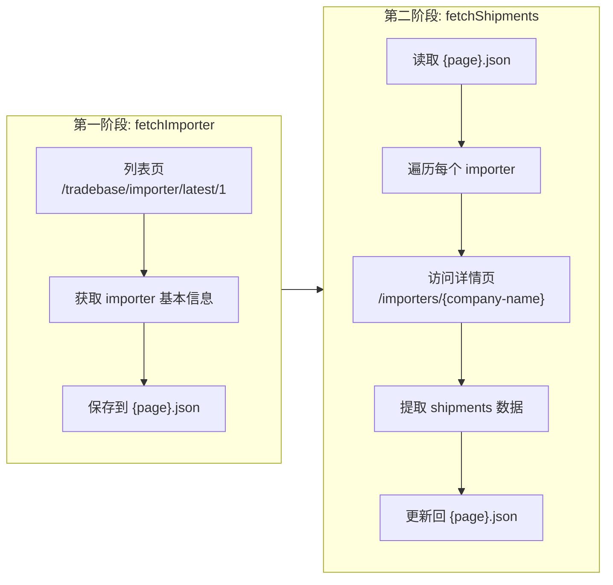
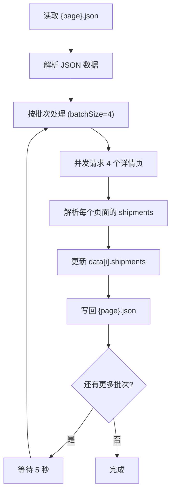
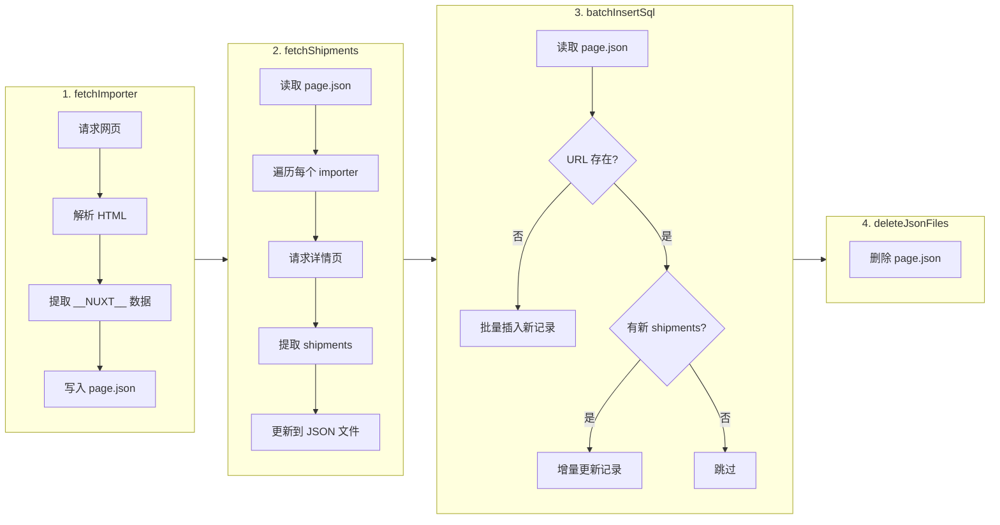
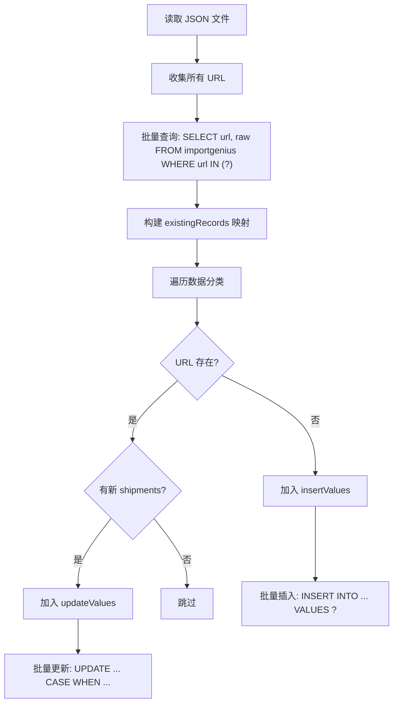
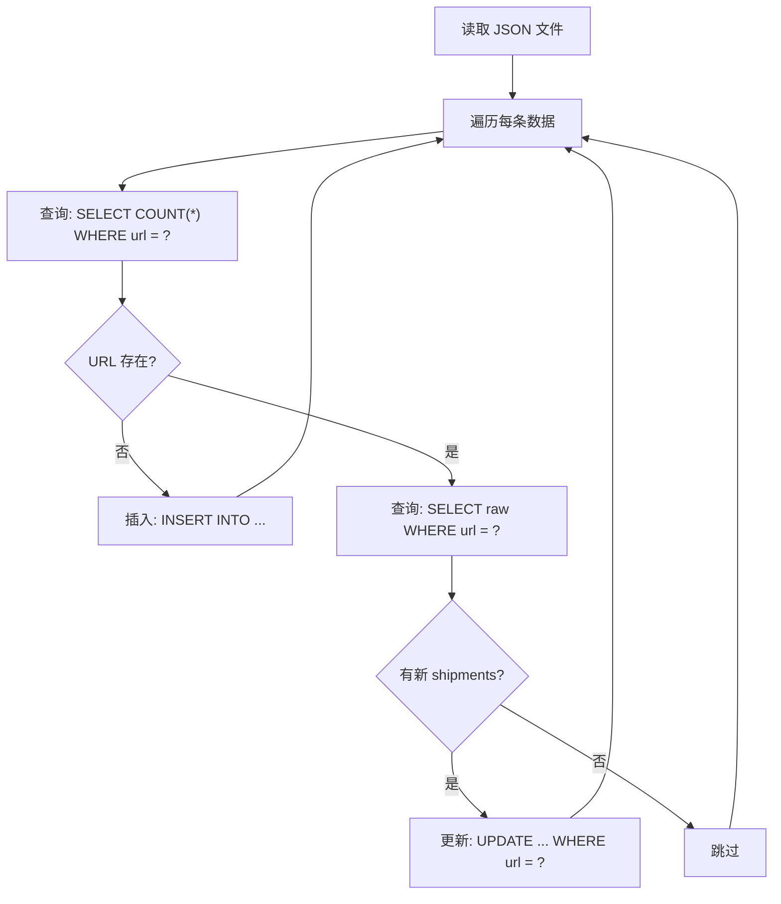

# getData.js 流程分析文档

## 一、整体架构流程图



## 二、文件序号存储策略

### 📁 存储规则

| 项目 | 说明 |
|-----|------|
| **数据源 URL** | `https://www.importgenius.cn/{country}/tradebase/importer/latest/{pageNumber}` |
| **URL 排序** | `latest/1` = 最新数据，`latest/2` = 次新... **页码越大，数据越老** |
| **文件命名** | `{pageNumber}.json`，与 URL 页码一一对应 |
| **序号规则** | **序号越小 = 数据越新，序号越大 = 数据越老** |

### 🔄 增量爬取策略


**代码逻辑**（fetchImporter.js 第 47-73 行）：

```javascript
const getIndexByFile = (country) => {
    let jsonFiles = fs.readdirSync(directoryPath);
    // 按序号正序排列
    jsonFiles = jsonFiles.sort((a, b) => parseInt(a) - parseInt(b));
    
    // 获取最后（最大）的文件序号
    const lastJsonFile = jsonFiles[jsonFiles.length - 1]; // 例如: "200.json"
    
    // 从最大序号+1 开始继续爬取
    const startPage = parseInt(lastJsonFile) + 1;  // 201
    const endPage = startPage + 200;               // 401
}
```

### 📊 示例说明

假设当前 `importer/usa/` 目录下有文件 `1.json` 到 `200.json`：

| 文件 | 对应 URL | 数据新旧 |
|-----|---------|---------|
| `1.json` | `/latest/1` | 🆕 **最新数据** |
| `2.json` | `/latest/2` | 次新 |
| ... | ... | ... |
| `200.json` | `/latest/200` | 🕐 较老数据 |
| ⬇️ 下次爬取 | | |
| `201.json` | `/latest/201` | 更老的数据 |

### ⚠️ 注意事项

1. **数据是按时间倒序排列的**：第 1 页是最近的交易记录，往后翻页是更早的记录
2. **增量爬取是往历史方向延伸**：不是获取最新数据，而是获取更多历史数据
3. **如果需要获取最新数据**：需要重新从第 1 页开始爬取，但会与已有数据重复（依赖数据库去重）

### 🔄 getData.js vs 直接调用 fetchImporter 的差异

#### getData.js 的行为（固定覆盖 1-10）

```javascript
// getData.js 第 67-69 行
for (let page = 1; page <= 10; page++) {
    await fetchImporter(country, page);  // 固定传入 1-10
}
```

| 场景 | 目录状态 | 执行结果 |
|-----|---------|---------|
| 删除 usa 所有文件后执行 | 空目录 | 创建 `1.json` ~ `10.json` |
| 保留 usa 文件（1-1800.json）后执行 | 有 1800 个文件 | **覆盖** `1.json` ~ `10.json` |
| **结论** | - | **getData.js 总是操作 1-10.json，不管目录里有什么** |

#### 直接调用 fetchImporter 的行为（增量追加）

```javascript
// 不传页码参数时
fetchImporter('usa')  // 这时会使用 getIndexByFile() 的逻辑
```

| 场景 | 目录状态 | 执行结果 |
|-----|---------|---------|
| 删除 usa 所有文件后执行 | 空目录 | 从 `1.json` 开始创建 200 个文件 |
| 保留 usa 文件（1-1800.json）后执行 | 有 1800 个文件 | 从 `1801.json` 开始创建 200 个文件 |
| **结论** | - | **直接调用会从最后一个文件 +1 开始追加** |

#### 关键代码解释

```javascript
// fetchImporter.js 第 165-178 行
async function fetchImporter(country, scrapeArr = [] | number) {
    scrapeArr = Array.isArray(scrapeArr) ? scrapeArr : [scrapeArr]
    const { startPage, endPage } = getIndexByFile(country)
    
    if (!scrapeArr.length) {  // ← 关键判断
        // 只有 scrapeArr 为空时，才使用 getIndexByFile 的结果
        for (let i = startPage; i <= endPage; i++) {
            scrapeArr.push(i);
        }
    }
    // 当 getData.js 传入 page 参数时，scrapeArr = [page]
    // 不为空，所以跳过上面的 if 块
    // 直接使用传入的 page 值
}
```



### 🔍 数据时间验证

从 `usa/0.json` 的数据可以看到：

```json
{
  "mostRecentDate": 1713398400,  // 转换为: 2024-04-18
  "company": "ART OF GUTTER INC-FAIRFIELD"
}
```

---

## 三、两阶段数据采集流程详解

### 为什么需要两个步骤？

数据采集分为**两个阶段**，因为数据分布在**不同的页面**：



### 📊 两阶段数据对比

| 阶段 | 数据来源 | 获取的字段 | 示例 URL |
|-----|---------|-----------|----------|
| **fetchImporter** | 列表页 | company, contactInfo, shippers, totalShipments, mostRecentDate, url | `/tradebase/importer/latest/1` |
| **fetchShipments** | 详情页 | shipments（货运记录详情） | `/importers/fashion-consul-international-s-a` |

### 📄 数据结构变化

**fetchImporter 执行后**（只有基本信息）：
```json
{
  "company": "FASHION CONSUL INTERNATIONAL S A",
  "totalShipments": 21915,
  "contactInfo": "...",
  "shippers": { ... },
  "url": "panama/importers/fashion-consul-international-s-a",
  "shipments": null  // ← 还没有 shipments 数据
}
```

**fetchShipments 执行后**（补充了货运详情）：
```json
{
  "company": "FASHION CONSUL INTERNATIONAL S A",
  "totalShipments": 21915,
  "contactInfo": "...",
  "shippers": { ... },
  "url": "panama/importers/fashion-consul-international-s-a",
  "shipments": [  // ← 补充了 shipments 详情
    {
      "BillOfLading": "COSU6279384890",
      "ProductDescription": ["8471.30", "COMPUTER PARTS"],
      "ArrivalDate": 1720656000,
      ...
    }
  ]
}
```

### 🔄 fetchShipments 详细流程



### ⚠️ 为什么需要分开执行？

1. **数据源不同**：列表页和详情页是不同的 URL
2. **请求数量差异**：
   - 列表页：1 页 = 1 个请求
   - 详情页：1 页数据 ≈ 20-50 个 importer = 20-50 个请求
3. **速率限制**：详情页请求量大，需要分批处理并等待，避免被封禁
4. **容错设计**：分开执行便于单独重试失败的步骤

---

## 四、数据处理详细流程图



## 四、问题分析与解答

### 问题 1：fetchDatas 失败时，日志打印到哪个地址？

**答案**：日志同时输出到 **两个位置**：

| 输出位置 | 说明 |
|---------|------|
| **控制台 (Console)** | 实时显示在终端 |
| **schedule.log 文件** | 位于执行目录下的 `schedule.log` 文件 |

```javascript
// 日志配置 (getData.js 第 46-56 行)
const logger = winston.createLogger({
    transports: [
        new winston.transports.Console(),              // 控制台输出
        new winston.transports.File({ filename: 'schedule.log' })  // 文件输出
    ]
});
```

⚠️ **注意**：`schedule.log` 使用的是相对路径，所以日志文件会生成在 **程序执行时的工作目录** 下，而不是 `getData.js` 所在目录。如果使用 PM2 启动，需要确认 PM2 的 `cwd` 配置。

---

### 问题 2：每次 fetchDatas 执行后，都会删除对应的 JSON 文件吗？

**答案**：**不一定会删除！存在严重的 BUG！** 🐛

#### 问题分析：

```javascript
// getData.js 第 66-84 行
async function fetchDatas(country) {
    try {
        for (let page = 1; page <= 10; page++) {
            await fetchImporter(country, page);      // ① 拉取数据
            await fetchShipments(country, page, false); // ② 补充 shipments
            await batchInsertSql(country, page);     // ③ 插入数据库
            await deleteJsonFiles(country, page);    // ④ 删除文件
        }
    } catch (error) {
        logger.error(`Error processing pages: ${error.message}`);
        // ❌ 错误后直接退出，不会继续处理！
    }
}
```

#### 文件不会被删除的情况：

| 场景 | 结果 |
|-----|------|
| `fetchImporter` 失败 | 当前页及后续所有页的文件都不会被创建/删除 |
| `fetchShipments` 失败 | 当前页文件已创建但不会被删除 |
| `batchInsertSql` 失败 | 当前页文件已创建但不会被删除 |
| `deleteJsonFiles` 失败 | 当前页文件不会被删除，后续页也不会处理 |
| 网络超时/服务器重启 | 已创建的文件不会被删除 |

#### 这就是为什么服务器上文件越来越多的原因！

```
importer/
├── argentina/     [406 files] ❌ 堆积
├── chile/         [201 files] ❌ 堆积
├── colombia/      [201 files] ❌ 堆积
├── usa/           [1799 files] ❌ 严重堆积
...
```

---

### 问题 3：如何判断哪些文件已入库？是否有去重逻辑？

#### ✅ 好消息：数据库有去重逻辑！

`batchInsertSql.js` 的入库逻辑**已经包含去重**：

```javascript
// batchInsertSql.js 第 93-107 行
const selectQueryUrls = 'SELECT url, raw FROM importgenius WHERE url IN (?)';

// 批量查询已存在的记录
const [rows] = await connection.query(selectQueryUrls, [urls]);
rows.forEach(row => {
    existingRecords[row.url] = row;
});

// 第 126-128 行
if (!existingRecord) {
    insertValues.push(values);  // URL 不存在 → 插入
} else {
    // URL 已存在 → 检查是否需要增量更新 shipments
}
```

**去重规则**：
1. **主键**：`url` 字段
2. **新记录**：URL 不存在 → 直接插入
3. **已存在记录**：基于 `BillOfLading` 比对 shipments，只添加新的

#### 🔄 重新入库方案

**方法一：直接重新执行入库（推荐）**

```bash
# 在项目目录下执行
cd /Users/liangweihong/Documents/import-data/importgenius

# 对指定国家重新入库所有 JSON 文件
node -e "require('./utils/batchInsertSql').batchInsertSql('usa')"
node -e "require('./utils/batchInsertSql').batchInsertSql('chile')"
# ... 其他国家
```

不传 `fileNumber` 参数时，`batchInsertSql` 会自动读取该国家目录下的**所有 JSON 文件**并处理。

**方法二：创建批量重新入库脚本**

```javascript
// reInsertAll.js
const { batchInsertSql } = require('./utils/batchInsertSql');

const countryList = [
    'usa', 'india', 'vietnam', 'argentina', 'chile',
    'colombia', 'costarica', 'ecuador', 'panama',
    'peru', 'paraguay', 'uruguay', 'venezuela'
];

(async () => {
    for (const country of countryList) {
        console.log(`Processing ${country}...`);
        await batchInsertSql(country);
        console.log(`${country} completed!`);
    }
})();
```

---

## 五、建议修复方案

### 修复 1：改进错误处理，确保单页失败不影响其他页

```javascript
async function fetchDatas(country) {
    for (let page = 1; page <= 10; page++) {
        try {
            await fetchImporter(country, page);
            logger.info(`[FetchImporter] Fetched importer for page: ${page} success`);

            await fetchShipments(country, page, false);
            logger.info(`[FetchShipments] Fetched shipments for page: ${page} success`);

            await batchInsertSql(country, page);
            logger.info(`[BatchInsertSql] Inserted data to database, page: ${page}`);

            await deleteJsonFiles(country, page);
            logger.info(`[DeleteFiles] Deleted JSON file for page: ${page}`);
            
        } catch (error) {
            // ✅ 单页失败只记录错误，继续处理下一页
            logger.error(`Error processing page ${page} for ${country}: ${error.message}`);
            continue;
        }
    }
}
```

### 修复 2：添加清理残留文件的功能

```javascript
async function cleanupJsonFiles(country) {
    const directoryPath = path.join(__dirname, `../importer/${country}`);
    const files = await fs.readdir(directoryPath);
    
    for (const file of files) {
        if (file.endsWith('.json')) {
            try {
                // 先尝试入库
                const page = parseInt(file);
                await batchInsertSql(country, page);
                logger.info(`Re-inserted data for ${country}/${file}`);
                
                // 入库成功后删除
                await fs.unlink(path.join(directoryPath, file));
                logger.info(`Cleaned up ${country}/${file}`);
            } catch (error) {
                logger.error(`Failed to cleanup ${country}/${file}: ${error.message}`);
            }
        }
    }
}
```

### 修复 3：日志文件使用绝对路径

```javascript
const logFilePath = path.join(__dirname, 'schedule.log');

const logger = winston.createLogger({
    transports: [
        new winston.transports.Console(),
        new winston.transports.File({ filename: logFilePath })
    ]
});
```

---

## 六、当前服务器文件状态

| 国家 | 文件数量 | 状态 |
|-----|---------|------|
| usa | 1799 | ⚠️ 大量堆积 |
| argentina | 406 | ⚠️ 堆积 |
| india | 326 | ⚠️ 堆积 |
| uruguay | 217 | ⚠️ 堆积 |
| chile | 201 | ⚠️ 堆积 |
| colombia | 201 | ⚠️ 堆积 |
| costarica | 202 | ⚠️ 堆积 |
| ecuador | 201 | ⚠️ 堆积 |
| peru | 201 | ⚠️ 堆积 |
| paraguay | 201 | ⚠️ 堆积 |
| vietnam | 201 | ⚠️ 堆积 |
| panama | 1 | 正常 |
| turkey | 0 | 正常 |
| venezuela | 0 | 正常 |

**建议**：执行批量重新入库后，手动删除已入库的 JSON 文件。

---

## 七、入库脚本对比分析

系统中有两个入库脚本：`batchInsertSql.js`（批量版）和 `insertSql.js`（单条版）。

### 📊 功能对比

| 特性 | `batchInsertSql.js` | `insertSql.js` |
|-----|---------------------|----------------|
| **操作方式** | 批量操作 | 逐条操作 |
| **查询策略** | 一次查询所有 URL | 每条记录单独查询 |
| **插入方式** | `INSERT INTO ... VALUES ?` 批量插入 | 逐条 `INSERT` |
| **更新方式** | `CASE WHEN` 批量更新 | 逐条 `UPDATE` |
| **性能** | ⚡ 高（减少数据库交互） | 🐢 低（大量数据库交互） |
| **模块化** | ✅ 导出为模块 | ❌ 独立脚本 |
| **参数化** | ✅ 支持 `country`, `fileNumber` 参数 | ❌ 需修改代码中的变量 |
| **环境配置** | 使用 `ENV` 环境变量区分 | 硬编码配置 |
| **使用场景** | 被 `getData.js` 调用 | 手动执行单次导入 |

### 🔄 batchInsertSql.js 流程



### 🔄 insertSql.js 流程



### 📝 代码差异详解

#### 1. 数据库配置

**batchInsertSql.js** - 使用环境变量：
```javascript
const isLive = process.env.ENV === 'production'
const dbConfig = isLive ? {
    host: '43.156.33.21',  // 生产环境
    // ...
} : {
    host: 'localhost',      // 本地环境
    // ...
}
```

**insertSql.js** - 硬编码配置：
```javascript
const localDbConfig = { host: 'localhost', ... }
const cloudDbConfig = { host: '43.156.33.21', ... }
// 需要手动修改使用哪个配置
const connection = await mysql.createConnection(cloudDbConfig);
```

#### 2. 查询策略

**batchInsertSql.js** - 批量查询（1 次）：
```javascript
const urls = data.map(item => item.url);
const [rows] = await connection.query(
    'SELECT url, raw FROM importgenius WHERE url IN (?)', 
    [urls]
);
```

**insertSql.js** - 逐条查询（N 次）：
```javascript
for (const item of data) {
    const [urlRows] = await connection.query(
        'SELECT COUNT(*) AS count FROM importgenius WHERE url = ?', 
        [item.url]
    );
    // ... 如果存在还要再查一次获取 raw
    const [existingRows] = await connection.query(
        'SELECT raw FROM importgenius WHERE url = ?', 
        [item.url]
    );
}
```

#### 3. 插入策略

**batchInsertSql.js** - 批量插入（1 次）：
```javascript
const insertValues = []; // 收集所有新记录
// ... 循环收集
await connection.query(
    'INSERT INTO importgenius (...) VALUES ?', 
    [insertValues]  // 一次插入所有
);
```

**insertSql.js** - 逐条插入（N 次）：
```javascript
for (const item of data) {
    await connection.query(
        'INSERT INTO importgenius (...) VALUES (?, ?, ?, ?, ?, ?, ?)', 
        values
    );
}
```

#### 4. 更新策略

**batchInsertSql.js** - CASE WHEN 批量更新（1 次）：
```javascript
let updateSql = 'UPDATE importgenius SET ';
updateSql += 'totalShipments = CASE url ';
updateValues.forEach(([totalShipments, , , url]) => {
    updateSql += `WHEN ${escape(url)} THEN ${escape(totalShipments)} `;
});
updateSql += 'END, ...';
updateSql += `WHERE url IN (${urlsToUpdate.join(', ')})`;
await connection.query(updateSql);
```

**insertSql.js** - 逐条更新（N 次）：
```javascript
for (const item of data) {
    await connection.query(
        'UPDATE importgenius SET totalShipments = ?, mostRecentDate = ?, raw = ? WHERE url = ?',
        [totalShipments, mostRecentDate, raw, url]
    );
}
```

### 📈 性能对比示例

假设处理 1000 条数据，其中 800 条新增，200 条更新：

| 操作 | batchInsertSql.js | insertSql.js |
|-----|-------------------|--------------|
| 查询 | 1 次 | 1000 + 200 = 1200 次 |
| 插入 | 1 次 | 800 次 |
| 更新 | 1 次 | 200 次 |
| **总计** | **3 次** | **2200 次** |

### 🎯 使用建议

| 场景 | 推荐使用 |
|-----|---------|
| 定时任务自动执行 | `batchInsertSql.js` |
| 大批量数据导入 | `batchInsertSql.js` |
| 手动调试单个文件 | `insertSql.js`（日志更详细） |
| 被其他模块调用 | `batchInsertSql.js` |

### ⚠️ 注意事项

1. **batchInsertSql.js** 的批量更新使用动态 SQL 拼接，当数据量过大时可能超出 SQL 长度限制
2. **insertSql.js** 的 `existingRaw` 没有 JSON.parse，可能导致比较逻辑异常（第 117 行）
3. 两个文件的去重逻辑相同，都是基于 `url` 字段和 `BillOfLading` 比对

---

## 八、总结

| 问题 | 结论 |
|-----|------|
| 日志位置 | 控制台 + `schedule.log`（相对路径） |
| 文件自动删除 | ❌ 存在 BUG，失败后不会删除且中断后续处理 |
| 去重逻辑 | ✅ 有，基于 `url` 字段去重，支持 shipments 增量更新 |
| 可否重新入库 | ✅ 可以，调用 `batchInsertSql(country)` 即可 |

